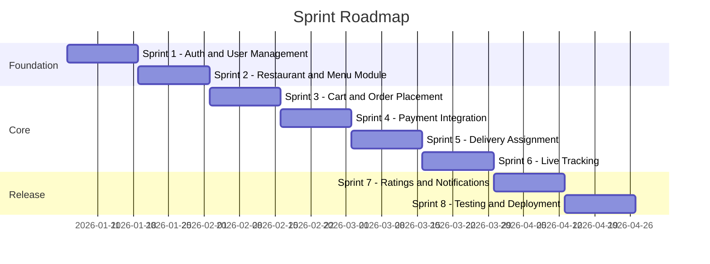
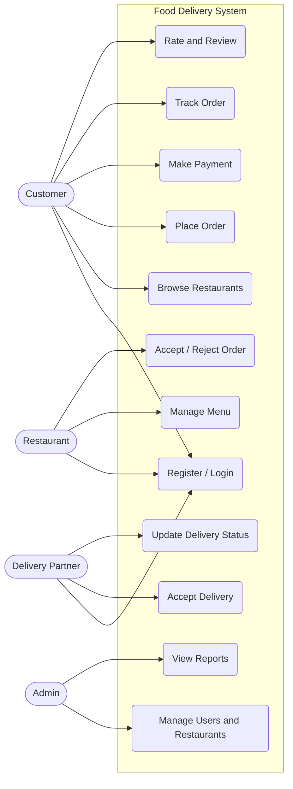
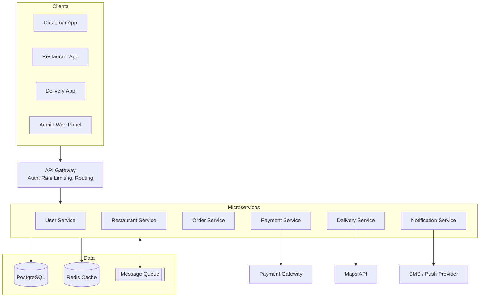
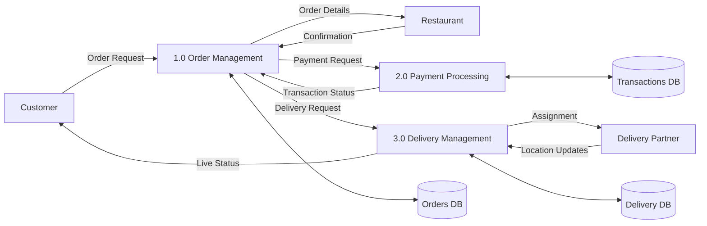
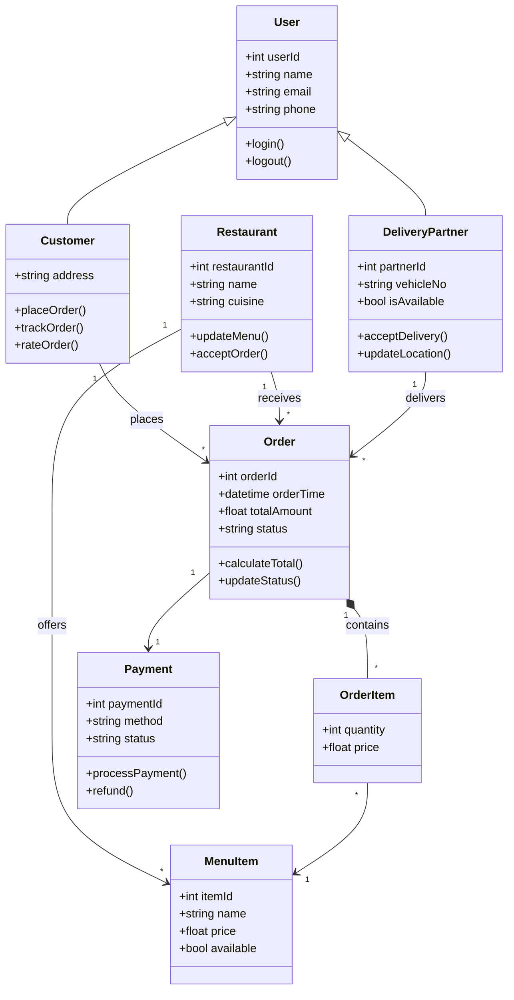
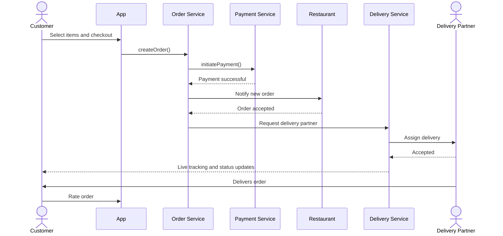
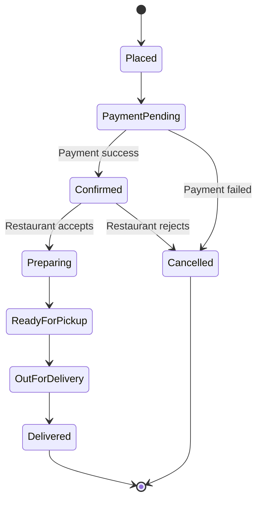
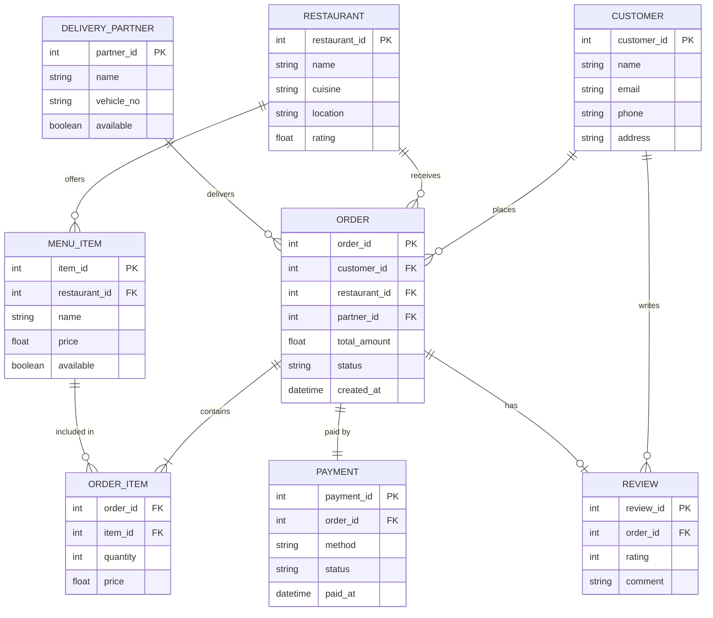

# 🍔 Online Food Delivery App: Software Engineering Case Study

> A complete software engineering case study of a Zomato/Swiggy-style food delivery platform, covering the full SDLC from requirements to maintenance.

**Author:** Nirvair Singh
**Institution:** Chandigarh University
**Subject:** Software Engineering

---

## 📑 Table of Contents

1. [Introduction](#1-introduction)
2. [Problem Statement](#2-problem-statement)
3. [Feasibility Study](#3-feasibility-study)
4. [SDLC Model Selection](#4-sdlc-model-selection)
5. [Requirements Analysis (SRS)](#5-requirements-analysis-srs)
6. [System Design](#6-system-design)
7. [Implementation](#7-implementation)
8. [Testing](#8-testing)
9. [Risk Management](#9-risk-management)
10. [Deployment and Maintenance](#10-deployment-and-maintenance)
11. [Project Estimation and Schedule](#11-project-estimation-and-schedule)
12. [Conclusion](#12-conclusion)
13. [References](#13-references)

---

## 1. Introduction

Online food delivery platforms connect **customers**, **restaurants**, and **delivery partners** through a single mobile/web application. Customers browse menus, place orders, pay online, and track delivery in real time.

This case study applies software engineering principles to plan, design, and validate such a system.

**Objectives**
- Identify and document functional and non-functional requirements
- Select a suitable SDLC model with justification
- Design the system using UML diagrams
- Define a testing and risk management strategy
- Plan deployment and maintenance

---

## 2. Problem Statement

Traditional food ordering relies on phone calls, which leads to:

| Problem | Impact |
|---|---|
| Order miscommunication | Wrong or missing items |
| No order tracking | Customer uncertainty |
| Limited restaurant reach | Lost revenue |
| Manual payment handling | Delays and errors |
| No feedback mechanism | Poor quality control |

**Proposed solution:** a centralized platform that automates ordering, payment, dispatch, and tracking for all stakeholders.

---

## 3. Feasibility Study

| Type | Assessment |
|---|---|
| **Technical** | Feasible using mature stacks (React Native, Node.js, PostgreSQL, Google Maps API, payment gateways such as Razorpay) |
| **Economic** | Revenue from commission (15 to 30%), delivery fees, and advertising; cost is mainly development, cloud hosting, and marketing |
| **Operational** | Users already familiar with app-based ordering; low training needed |
| **Schedule** | An MVP is achievable in 4 to 6 months with a small team |
| **Legal** | Must comply with food licensing (FSSAI in India), data protection, and payment regulations |

---

## 4. SDLC Model Selection

### Chosen model: **Agile (Scrum)**

| Criteria | Waterfall | Agile (Scrum) |
|---|---|---|
| Requirement changes | Hard to handle | Easily handled |
| Customer feedback | Only at the end | Every sprint |
| Time to first release | Long | Short (MVP early) |
| Risk | Discovered late | Discovered early |
| Fit for this project | ❌ | ✅ |

**Justification:** Food delivery requirements evolve quickly (new payment methods, offers, features). Agile allows incremental delivery, continuous feedback, and quick adaptation.

**Sprint plan (2-week sprints)**



---

## 5. Requirements Analysis (SRS)

### 5.1 Stakeholders

| Actor | Role |
|---|---|
| **Customer** | Browses, orders, pays, tracks, reviews |
| **Restaurant Owner** | Manages menu, accepts/rejects orders |
| **Delivery Partner** | Accepts deliveries, updates status |
| **Admin** | Manages users, restaurants, disputes, analytics |

### 5.2 Functional Requirements

| ID | Requirement |
|---|---|
| FR1 | Users shall register and log in using email/phone with OTP verification |
| FR2 | Customers shall search restaurants by name, cuisine, or location |
| FR3 | Customers shall view menus, add items to the cart, and apply coupons |
| FR4 | The system shall support online payments (UPI, cards, wallets) and cash on delivery |
| FR5 | Restaurants shall accept or reject incoming orders and update preparation status |
| FR6 | The system shall automatically assign the nearest available delivery partner |
| FR7 | Customers shall track the order in real time on a map |
| FR8 | Customers shall rate and review restaurants and delivery partners |
| FR9 | The system shall send push/SMS notifications on order status changes |
| FR10 | Admin shall manage users, restaurants, offers, and view reports |

### 5.3 Non-Functional Requirements

| Category | Requirement |
|---|---|
| **Performance** | Page/API response under 2 seconds for 95% of requests |
| **Scalability** | Support 10,000+ concurrent users during peak hours |
| **Availability** | 99.9% uptime |
| **Security** | HTTPS, encrypted passwords (bcrypt), PCI-DSS compliant payments, JWT authentication |
| **Usability** | Order placement within 5 taps/clicks from the home screen |
| **Reliability** | No order or payment data loss on system failure |
| **Compatibility** | Android, iOS, and modern web browsers |
| **Maintainability** | Modular architecture with at least 80% unit test coverage |

### 5.4 User Stories (Sample)

- As a **customer**, I want to track my order live so that I know when to expect it.
- As a **restaurant owner**, I want to mark items out of stock so that customers can't order them.
- As a **delivery partner**, I want to see the optimal route so that I can deliver faster.
- As an **admin**, I want to view daily revenue reports so that I can monitor business performance.

---

## 6. System Design

### 6.1 Use Case Diagram



### 6.2 System Architecture

A **microservices-based, layered architecture** is used for scalability and independent deployment.



### 6.3 Data Flow Diagram (Level 1)



### 6.4 Class Diagram



### 6.5 Sequence Diagram: Placing an Order



### 6.5 State Diagram: Order Lifecycle



### 6.6 Database Design (ER Diagram)



---

## 7. Implementation

### 7.1 Technology Stack

| Layer | Technology |
|---|---|
| Mobile App | React Native / Flutter |
| Web Admin Panel | React.js |
| Backend | Node.js (Express) |
| Database | PostgreSQL, Redis (caching) |
| Messaging | RabbitMQ / Kafka |
| Maps and Tracking | Google Maps API, WebSockets |
| Payments | Razorpay / Stripe |
| Notifications | Firebase Cloud Messaging |
| Cloud | AWS / GCP |
| CI/CD | GitHub Actions, Docker |

### 7.2 Suggested Project Structure

```
food-delivery-app/
├── client/
│   ├── customer-app/
│   ├── restaurant-app/
│   └── delivery-app/
├── services/
│   ├── user-service/
│   ├── restaurant-service/
│   ├── order-service/
│   ├── payment-service/
│   ├── delivery-service/
│   └── notification-service/
├── api-gateway/
├── docs/
├── docker-compose.yml
└── README.md
```

### 7.3 Key Design Principles Applied

- **Separation of concerns:** each microservice owns one business domain
- **SOLID principles** in the service layer
- **Design patterns:** Observer (order status notifications), Strategy (payment methods), Factory (user types)
- **Version control:** Git with feature-branch workflow and pull request reviews

---

## 8. Testing

### 8.1 Testing Levels

| Level | Description | Tools |
|---|---|---|
| Unit | Individual functions/classes | Jest, JUnit |
| Integration | Interaction between services | Postman, Supertest |
| System | End-to-end workflows | Selenium, Cypress |
| Performance | Load and stress | JMeter, k6 |
| Security | Vulnerability scanning | OWASP ZAP |
| UAT | Real-user validation | Beta testers |

### 8.2 Sample Test Cases

| ID | Scenario | Input | Expected Result | Status |
|---|---|---|---|---|
| TC01 | Valid login | Correct email + OTP | User logged in | Pass |
| TC02 | Invalid OTP | Wrong OTP | Error message shown | Pass |
| TC03 | Add item to cart | Select menu item | Cart total updated | Pass |
| TC04 | Apply valid coupon | Valid code | Discount applied | Pass |
| TC05 | Apply expired coupon | Expired code | "Coupon expired" message | Pass |
| TC06 | Payment failure | Insufficient funds | Order not confirmed, retry offered | Pass |
| TC07 | Restaurant rejects order | Reject action | Customer notified, refund initiated | Pass |
| TC08 | Live tracking | Order out for delivery | Map shows partner location | Pass |
| TC09 | Peak load | 10,000 concurrent users | Response time under 2 s | Pass |
| TC10 | SQL injection attempt | Malicious input in search | Input sanitized, request blocked | Pass |

---

## 9. Risk Management

| Risk | Probability | Impact | Mitigation |
|---|---|---|---|
| Payment gateway downtime | Medium | High | Support multiple gateways with fallback |
| Server overload at peak hours | High | High | Auto-scaling, caching, load balancing |
| Data breach | Low | Very High | Encryption, regular audits, access control |
| Poor GPS accuracy | Medium | Medium | Combine GPS with network location, manual correction |
| Scope creep | High | Medium | Sprint planning, backlog prioritization |
| Delivery partner shortage | Medium | High | Incentives, dynamic pricing, demand forecasting |
| Third-party API changes | Low | Medium | Abstraction layer around external APIs |

---

## 10. Deployment and Maintenance

### Deployment
- Containerized with **Docker**, orchestrated using **Kubernetes**
- **CI/CD pipeline:** commit → build → automated tests → staging → production
- Blue-green deployment for zero-downtime releases

### Maintenance Types

| Type | Example |
|---|---|
| **Corrective** | Fixing a bug in coupon calculation |
| **Adaptive** | Supporting a new OS version or payment method |
| **Perfective** | Improving search speed and UI |
| **Preventive** | Refactoring code, upgrading dependencies |

### Monitoring
Prometheus + Grafana for metrics, ELK stack for logs, and alerting for downtime or error spikes.

---

## 11. Project Estimation and Schedule

### COCOMO (Basic, Semi-detached mode)

Assume the estimated size is **30 KLOC**.

- Effort = a × (KLOC)^b = 3.0 × (30)^1.12 ≈ **134 person-months**
- Development time = c × (Effort)^d = 2.5 × (134)^0.35 ≈ **14 months**
- Average team size = Effort / Time ≈ **10 people**

> For an MVP with reduced scope, this shrinks to roughly 4 to 6 months with a team of 5 to 6.

### Team Structure

| Role | Count |
|---|---|
| Product Owner / Project Manager | 1 |
| Backend Developers | 2 |
| Mobile/Frontend Developers | 2 |
| QA Engineer | 1 |
| DevOps Engineer | 1 |
| UI/UX Designer | 1 |

---

## 12. Conclusion

This case study shows how software engineering practices can be applied to build a food delivery platform: choosing **Agile** to handle changing requirements, documenting clear **functional and non-functional requirements**, modelling the system with **UML**, planning multi-level **testing**, and managing **risks** proactively.

**Key learnings**
- Early requirement analysis prevents costly rework
- A modular microservices design improves scalability and maintainability
- Continuous testing and CI/CD improve quality and release speed
- Risk planning is essential for systems that depend on third-party services

**Future enhancements:** AI-based recommendations, drone/robot delivery, subscription plans, voice ordering, and demand prediction.

---

## 13. References

1. Pressman, R. S., *Software Engineering: A Practitioner's Approach*, McGraw-Hill
2. Sommerville, I., *Software Engineering*, Pearson
3. Schwaber, K. and Sutherland, J., *The Scrum Guide*
4. IEEE Std 830-1998, *Recommended Practice for Software Requirements Specifications*
5. Fowler, M., *UML Distilled*, Addison-Wesley

---

⭐ If you found this case study helpful, consider starring the repository!
